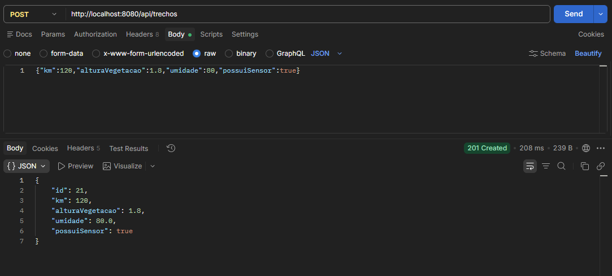
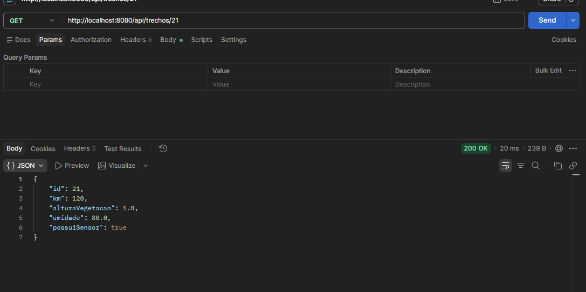
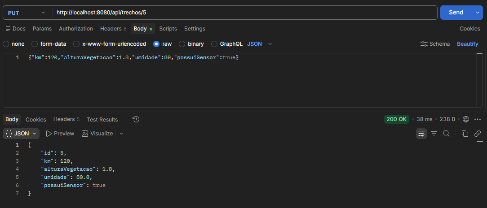
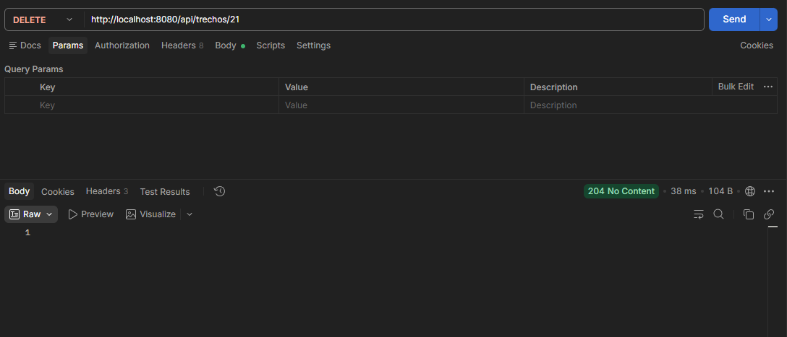
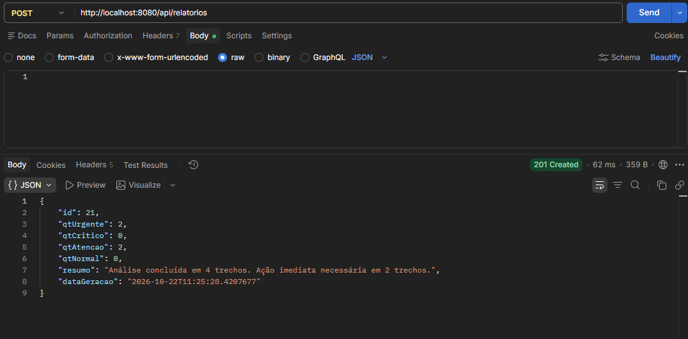
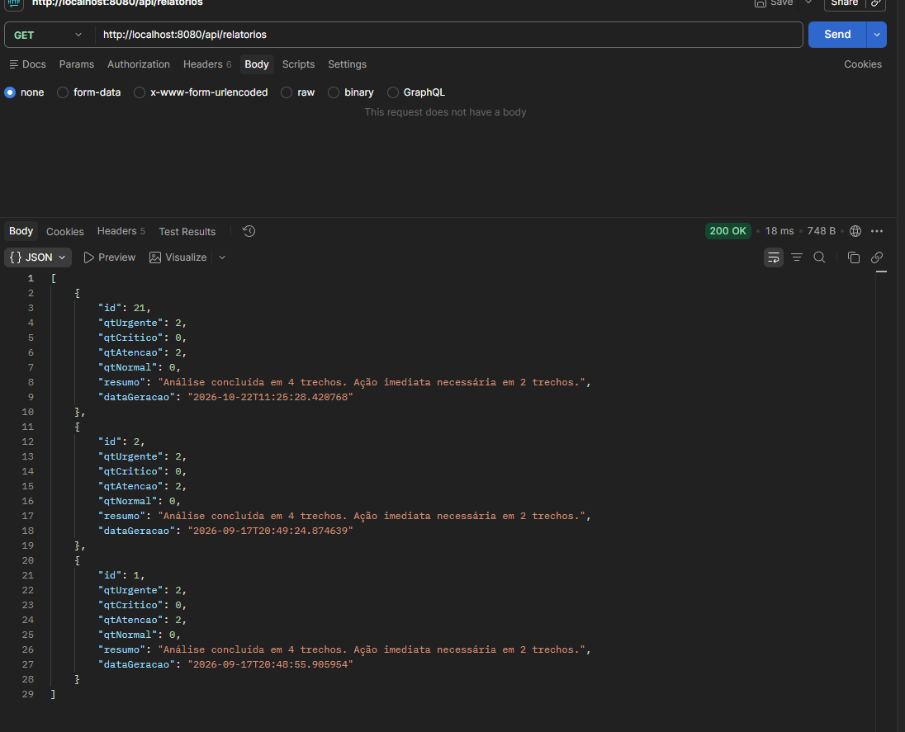
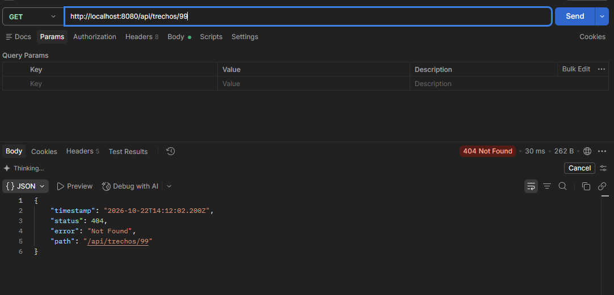

# MOTIVA — API REST (Sprint 4)

API REST de monitoramento de vegetação em rodovias, construída com **Spring Boot 4.1 + Spring Data JPA** sobre o banco **Oracle FIAP**. Esta sprint migra o protótipo da Sprint 3 (JDBC puro) para uma API profissional, reaproveitando as tabelas já modeladas.

---

## Tecnologias

Java 17 · Maven · Spring Boot 4.1.0 · Spring Web MVC · Spring Data JPA (Hibernate) · Bean Validation · Oracle JDBC (`ojdbc17`)

## Arquitetura

```
Controller  →  Service  →  Repository  →  Oracle
 (HTTP/JSON)   (regras)     (Spring Data)
```

```
src/main/
├── java/com/projetoMotiva/
│   ├── MotivaApplication.java
│   ├── controller/   
│   ├── service/      
│   ├── repository/   
│   ├── model/        
│   ├── dto/         
│   ├── exception/    
│   ├── interfaces/   
│   └── mock/       
└── resources/
    └── application.properties
```

## Como executar

### 1. Credenciais (variáveis de ambiente)
O projeto **não guarda senha no código**. O `application.properties` lê `DB_USER` e `DB_PASSWORD`:

**PowerShell**
```powershell
$env:DB_USER="seu_rm"
$env:DB_PASSWORD="sua_senha"
```

**Linux / macOS / Git Bash**
```bash
export DB_USER=seu_rm
export DB_PASSWORD=sua_senha
```

No IntelliJ: *Run > Edit Configurations > Environment variables* → `DB_USER=seu_rm;DB_PASSWORD=sua_senha`.
O arquivo `.env.example` mostra os nomes das variáveis.

### 2. Subir a API
```bash
mvn spring-boot:run
```
Ou execute a classe `MotivaApplication` pela IDE. A API sobe em `http://localhost:8080`.

---

## Endpoints

### Trechos — `/api/trechos`
| Método | Rota | Ação | Sucesso | Erros |
|---|---|---|---|---|
| GET | `/api/trechos` | Listar todos | 200 | — |
| GET | `/api/trechos/{id}` | Buscar por ID | 200 | 404 |
| POST | `/api/trechos` | Criar | 201 | 400 |
| PUT | `/api/trechos/{id}` | Atualizar | 200 | 400 / 404 |
| DELETE | `/api/trechos/{id}` | Remover | 204 | 404 |
| GET | `/api/trechos/km-minimo/{km}` | Trechos com km >= valor | 200 | 400 |
| GET | `/api/trechos/altura-minima/{altura}` | Trechos com altura >= valor (m) | 200 | 400 |
| GET | `/api/trechos/sensor/{true\|false}` | Por presença de sensor IoT | 200 | 400 |

### Equipes — `/api/equipes`
| Método | Rota | Ação | Sucesso | Erros |
|---|---|---|---|---|
| GET | `/api/equipes` | Listar todas | 200 | — |
| GET | `/api/equipes/{id}` | Buscar por ID | 200 | 404 |
| POST | `/api/equipes` | Criar | 201 | 400 |
| PUT | `/api/equipes/{id}` | Atualizar | 200 | 400 / 404 |
| DELETE | `/api/equipes/{id}` | Remover | 204 | 404 |
| GET | `/api/equipes/disponivel/{true\|false}` | Por disponibilidade | 200 | 400 |
| GET | `/api/equipes/especialidade/{texto}` | Por especialidade | 200 | 400 |

### Intervenções — `/api/intervencoes`
| Método | Rota | Ação | Sucesso | Erros |
|---|---|---|---|---|
| GET | `/api/intervencoes` | Listar todas | 200 | — |
| GET | `/api/intervencoes/{id}` | Buscar por ID | 200 | 404 |
| POST | `/api/intervencoes` | Criar | 201 | 400 |
| PUT | `/api/intervencoes/{id}` | Atualizar | 200 | 400 / 404 |
| DELETE | `/api/intervencoes/{id}` | Remover | 204 | 404 |
| GET | `/api/intervencoes/tipo/{tipo}` | Por tipo | 200 | 400 |
| GET | `/api/intervencoes/status/{status}` | Por status | 200 | 400 |

### Relatórios — `/api/relatorios`
| Método | Rota | Ação | Sucesso | Erros |
|---|---|---|---|---|
| POST | `/api/relatorios` | Gera o relatório com os trechos atuais **e persiste** no histórico (sem corpo) | 201 | 400 (sem trechos) |
| GET | `/api/relatorios` | Lista o histórico (mais recente primeiro) | 200 | — |
| GET | `/api/relatorios/periodo?inicio=AAAA-MM-DD&fim=AAAA-MM-DD` | Histórico por período | 200 | 400 |

### Corpos de requisição

**Trecho** (`POST` / `PUT`)
```json
{ "km": 120, "alturaVegetacao": 1.8, "umidade": 80.0, "possuiSensor": true }
```

**Equipe** (`POST` / `PUT`)
```json
{ "nome": "Equipe Delta", "especialidade": "Pulverização", "disponivel": true }
```

**Intervenção** (`POST` / `PUT`)
```json
{ "tipo": "Roçada Mecanizada", "kmTrecho": 60, "status": "Pendente" }
```

---

## Regras de negócio

**Classificação de prioridade** (`MotorPriorizacao`, altura em metros):

| Nível | Condição |
|---|---|
| URGENTE | altura > 1,5 m **e** umidade > 70% |
| CRÍTICO | altura > 1,5 m |
| ATENÇÃO | 1,0 m ≤ altura ≤ 1,5 m |
| NORMAL | altura < 1,0 m |

**Validações** (camada Service, com Bean Validation nos DTOs):
- Trecho: km ≥ 0 · altura entre 0 e 999,99 · umidade entre 0 e 100.
- Equipe: nome e especialidade obrigatórios (máx. 100 caracteres).
- Intervenção: tipo ∈ {Pulverização, Roçada Mecanizada} · status ∈ {Pendente, Em andamento, Concluído} · o tipo não pode ser alterado em um `PUT`.

**Polimorfismo:** `IntervencaoOperacional` é abstrata, com as subclasses `Pulverizacao` e `RocadaMecanizada` (herança JPA em tabela única). O campo `servico` da resposta vem de `executarServico()`, que cada subclasse implementa de um jeito.

## Tratamento de erros

As exceções `RecursoNaoEncontradoException` (404) e `RegraNegocioException` (400) usam `@ResponseStatus`. Falhas de Bean Validation (`@Valid`) também retornam 400. O corpo segue o formato padrão do Spring Boot, com `server.error.include-message=always`:

```json
{
  "timestamp": "2026-10-22T11:30:00.000+00:00",
  "status": 404,
  "error": "Not Found",
  "message": "Trecho não encontrado com ID: 99999",
  "path": "/api/trechos/99999"
}
```

---

## Exemplos cURL

> No PowerShell use `curl.exe` ou o Postman. Em Git Bash e Linux os comandos funcionam como estão.

```bash
# Listar trechos (200)
curl -i http://localhost:8080/api/trechos

# Criar trecho (201) — anote o "id" da resposta
curl -i -X POST http://localhost:8080/api/trechos \
  -H "Content-Type: application/json" \
  -d '{"km": 120, "alturaVegetacao": 1.8, "umidade": 80.0, "possuiSensor": true}'

# Buscar por ID (200) — troque 1 pelo id criado
curl -i http://localhost:8080/api/trechos/1

# Atualizar (200)
curl -i -X PUT http://localhost:8080/api/trechos/1 \
  -H "Content-Type: application/json" \
  -d '{"km": 120, "alturaVegetacao": 0.9, "umidade": 55.0, "possuiSensor": true}'

# Remover (204)
curl -i -X DELETE http://localhost:8080/api/trechos/1

# ID inexistente (404)
curl -i http://localhost:8080/api/trechos/99999

# Dado inválido (400)
curl -i -X POST http://localhost:8080/api/trechos \
  -H "Content-Type: application/json" \
  -d '{"km": -5, "alturaVegetacao": 1.0, "umidade": 150, "possuiSensor": true}'

# Criar equipe (201)
curl -i -X POST http://localhost:8080/api/equipes \
  -H "Content-Type: application/json" \
  -d '{"nome": "Equipe Delta", "especialidade": "Pulverização", "disponivel": true}'

# Criar intervenção (201)
curl -i -X POST http://localhost:8080/api/intervencoes \
  -H "Content-Type: application/json" \
  -d '{"tipo": "Roçada Mecanizada", "kmTrecho": 60, "status": "Pendente"}'

# Gerar relatório (201) — sem corpo, persiste no histórico
curl -i -X POST http://localhost:8080/api/relatorios

# Histórico (200) e consulta por período (200)
curl -i http://localhost:8080/api/relatorios
curl -i "http://localhost:8080/api/relatorios/periodo?inicio=2026-10-01&fim=2026-10-31"
```

---

## Evidências

Requisições executadas contra a API conectada ao Oracle FIAP:

| # | Requisição | Status | Print |
|---|---|---|---|
| 1 | `POST /api/trechos` | 201 |  |
| 2 | `GET /api/trechos/{id}` | 200 |  |
| 3 | `PUT /api/trechos/{id}` | 200 |  |
| 4 | `DELETE /api/trechos/{id}` | 204 |  |
| 5 | `POST /api/relatorios` | 201 |  |
| 6 | `GET /api/relatorios` | 200 |  |
| 7 | `GET /api/trechos/99999` | 404 |  |

---

## Perguntas de reflexão

**1. Por que o `Repository` é uma interface e não uma classe? Quem escreve a implementação e quando?**

Porque é apenas declarado contratos (`save`, `findAll`, `findByTipo`...). Quem escreve a implementação é o Spring Data JPA, **na inicialização da aplicação**: ele cria em tempo de execução um proxy que implementa a interface (baseado em `SimpleJpaRepository`). 

**2. O pattern DAO da Sprint 3 "morreu" na migração ou só mudou de forma?**

Só mudou de forma. A ideia do DAO, que é isolar o acesso a dados do resto do sistema. A diferença é que antes escrevíamos o DAO à mão (SQL, `PreparedStatement`, `ResultSet`, muitas linhas por entidade) e agora o `Repository` é um DAO gerado pelo framework.

**3. Por que a validação de `nivelVegetacao >= 0` deve ficar no Service e não no Controller?**

Porque é regra de negócio. O Controller só traduz requisição e resposta. Se a regra ficasse nele, qualquer outra porta de entrada poderia ignorá-la. No Service ela vale sempre, independentemente de quem o chamou.

**4. No JDBC puro escrevíamos SQL. Onde está o SQL do `findByTipo()`? Quem o gerou?**

Não está escrito em lugar nenhum do código. O Spring Data lê o nome do método (`findBy` + `Tipo`), monta uma consulta sobre o atributo `tipo` da entidade e o Hibernate a traduz para o SQL do Oracle em tempo de execução. 

---

## Integrantes:

1 - Miguel Vanucci RM: 563491

2 - Joao Vitor RM: 566541

3 - Samuel da Silva Nunes RM: 564435

4 - Henry dos Santos Lima RM: 565309
